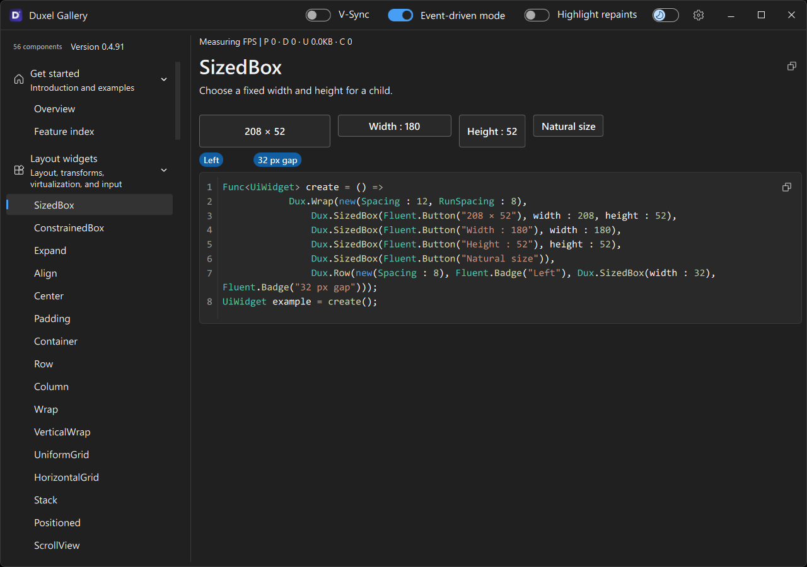
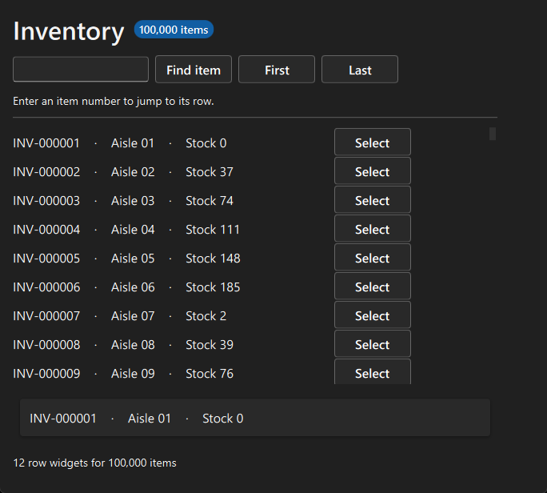

# Duxel · Windows와 Linux용 C# 크로스플랫폼 데스크톱 UI

**C# / .NET**으로 빠른 **Windows·Linux 데스크톱 앱**을 만들어 보세요. Duxel은 **Fluent 2** 컨트롤과 **Vulkan** 렌더러를 제공합니다. **AI 바이브 코딩**을 할 때 Gallery에서 필요한 컨트롤을 눌러 보고, 그 C# 코드를 AI에게 보여준 다음 파일 기반 앱(FBA)으로 바로 실행할 수 있습니다. 위젯과 상태 코드는 두 플랫폼에서 공유합니다.

[English](README.md) · [문서](docs/README.ko.md) · [예제](docs/fba-run-samples.ko.md) · [버전 이력](docs/version-history.ko.md)

## Duxel Gallery 0.4.0 실행하기

[.NET 11 SDK](https://dotnet.microsoft.com/en-us/download/dotnet/11.0)와 Vulkan을 사용할 수 있는 그래픽 환경이 필요합니다. Gallery에서 컨트롤, 레이아웃, 이미지, SVG, Markdown을 직접 써 보고 C# 코드를 복사할 수 있습니다.

### Windows에서 시작하기

PowerShell 7에서 Gallery를 파일 기반 앱으로 실행합니다.

~~~powershell
curl.exe -fsSLO https://raw.githubusercontent.com/dimohy/Duxel/v0.4.0/samples/fba/duxel_gallery.cs && dotnet run --file duxel_gallery.cs
~~~

### Linux에서 시작하기

Linux의 Bash에서 실행합니다. X11/Xwayland와 Vulkan이 준비된 WSLg에서도 실행할 수 있습니다. [Linux 설치 안내](docs/linux-platform.ko.md)

~~~bash
curl -fsSLO https://raw.githubusercontent.com/dimohy/Duxel/v0.4.0/samples/fba/duxel_gallery_linux.cs && dotnet run --file duxel_gallery_linux.cs
~~~

| Windows | Linux · Ubuntu 24.04, WSLg |
| --- | --- |
|  |  |

이 저장소의 라이브러리와 두 Gallery 프로젝트는 **.NET 8·9·10·11**을 대상으로 빌드합니다. 원하는 런타임을 골라 실행하는 방법은 [Gallery 사용법](docs/gallery-navigation.ko.md)에 있습니다. 위 다운로드 명령은 공개 0.4.0 실행 파일을 사용합니다.

## Duxel로 바이브 코딩 시작하기

1. **Gallery → Fluent 컨트롤 → 입력 및 선택 → Switch**에서 스위치를 눌러 보고, 예제 아래의 C# 코드를 복사합니다.
2. 빈 폴더에 [`gallery_controls.cs`](samples/fba/gallery_controls.cs)를 받아 AI 코딩 도구에서 그 폴더를 엽니다. 먼저 아래 명령으로 원본을 실행합니다. 스위치가 켜져 있을 때 Count 버튼을 눌러 숫자가 올라가는지 확인합니다.
3. 복사한 Gallery 코드와 함께 아래 프롬프트를 AI에 전달합니다.

> `gallery_controls.cs`를 열어 주세요. 첨부한 Gallery의 Switch 예제를 참고해서 **Reset count** 버튼을 추가해 주세요. 이 버튼은 스위치 상태를 그대로 두고 숫자만 0으로 돌려야 합니다. 기존 `UiState<int>`와 Fluent 컨트롤을 활용하고 Windows·Linux 호스트 설정과 패키지 버전을 유지해 주세요. 실행해서 스위치가 켜졌을 때 Count를 누르면 숫자가 1씩 오르고 Reset을 누르면 0이 되는지 확인해 주세요.

**Windows** · PowerShell 7

~~~powershell
dotnet run --file gallery_controls.cs
~~~

**Linux** · 그래픽 세션과 Fontconfig를 사용할 수 있는 Bash

~~~bash
dotnet run --file gallery_controls.cs -- "$(fc-match -f '%{file}' sans-serif)"
~~~

수정한 C# 파일을 Windows와 Linux에서 각각 실행해 스위치, 두 버튼, 카운트를 확인합니다. AI가 컨트롤의 사용법을 확인해야 할 때는 [API와 소스 위치](docs/duxel-agent-reference.ko.md)도 함께 전달합니다.

## Fluent 2 앱 예제

계산기, 메모장, 대용량 목록, 움직이는 도형은 Windows와 Linux에서 같은 C# 소스로 실행합니다. [예제별 준비 사항과 실행 명령](docs/fba-run-samples.ko.md)

| 예제 | 이렇게 써 보세요 |
| --- | --- |
| [계산기](samples/fba/duxel_calculator.cs) | 소수 연산을 이어서 하고 0으로 나누었을 때의 표시도 확인합니다. |
| [메모장](docs/fba-run-samples.ko.md#메모장) | 저장소에서 실행해 상단 메뉴로 텍스트 파일을 열고 저장합니다. |
| [대용량 목록](samples/fba/duxel_large_list.cs) | 10만 행을 스크롤하거나 마지막 행으로 바로 이동합니다. 화면에 가까운 행만 위젯으로 만듭니다. |
| [움직이는 도형](samples/fba/duxel_render_motion.cs) | 원의 수를 바꾸면서 같은 창에서 Fluent 2 컨트롤을 조작해 봅니다. |

## Fluent 2 YAML 미리 보기

YAML 화면 6개와 C# 동작 파일을 하나의 파일 기반 앱에서 씁니다. 소스 생성기는 빌드할 때 YAML을 Duxel 위젯 호출과 타입이 지정된 상태로 바꿉니다. 이 저장소에서 미리 보기용 생성기를 빌드한 뒤 네 가지 예제를 실행해 보세요. [Fluent 2 YAML 가이드](docs/fluent-dsl.ko.md)

## NativeAOT로 작은 실행 파일 만들기

Fluent 2 텍스트 컨트롤 하나를 띄우는 최소 앱을 용량 절약 옵션으로 게시한 결과, **Windows x64는 4.85 MB**(.NET 11 대상), **Linux x64는 4.98 MB**(.NET 10 대상)였습니다. 기본 게시 결과와 바이트 단위 실측값, 재현 명령은 [NativeAOT 가이드](docs/native-aot.ko.md)에 있습니다.

## 앱 만들기

- `Dux`로 배치하고 `Fluent`로 컨트롤을 만듭니다. `UiState<T>`를 연결하면 컨트롤끼리 값을 공유할 수 있습니다.
- Windows 또는 Linux 호스트를 프로젝트에서 참조하거나 파일 기반 앱에서 `#:package`로 지정합니다. 이 저장소는 .NET 8·9·10·11을 대상으로 빌드합니다. 공개 0.4.0 호스트 패키지는 .NET 8·9·10을 대상으로 하며, 위 Gallery 실행 명령에는 .NET 11 SDK가 필요합니다.

[C# 앱 시작하기](docs/getting-started-fba.ko.md) · [API와 소스 위치](docs/duxel-agent-reference.ko.md) · [AI 문서 색인](llms.txt)
