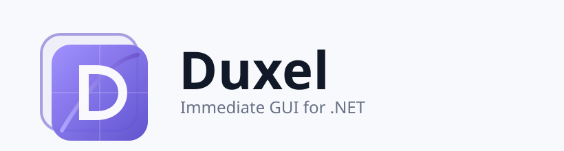

# Duxel

<p align="center">
  
</p>

Duxel은 네이티브 데스크톱 애플리케이션을 만드는 .NET UI 라이브러리입니다. C# 위젯을 조합해 Fluent 2 인터페이스를 만들거나, 즉시 모드 API로 직접 그리고 입력을 처리할 수 있습니다. 한 Vulkan 창에서 두 방식을 함께 쓸 수도 있습니다.

[](https://www.nuget.org/packages/Duxel.App)
[](https://licenses.nuget.org/MIT)

[English](README.md) · [문서](docs/README.ko.md) · [버전 이력](docs/version-history.ko.md)

## 인터페이스 만들기

- **위젯 방식**은 `Dux`로 레이아웃을 구성하고 `Fluent`로 컨트롤을 배치합니다. 애플리케이션 상태는 `UiState<T>`와 바인딩으로 연결합니다. C#과 선언형 `.ui` 파일을 사용할 수 있습니다.
- **즉시 모드**는 `UiScreen.Render`와 `UiImmediateContext`로 그리기, 맞춤 입력 처리, 진단 화면을 구현합니다. 같은 애플리케이션에 즉시 모드 콘텐츠와 위젯을 배치할 수 있습니다.
- **Fluent 2 테마**는 Windows 11의 밝은·어두운 디자인을 제공합니다. `UiTheme`, `UiDesignTokens`, `IUiDesign`으로 색상과 서체, 컨트롤 크기나 간격을 바꿀 수 있습니다. 테마 공급자를 사용하면 특정 영역에만 다른 테마를 적용할 수 있습니다.

가상화 목록과 데이터 그리드, SVG와 Markdown 위젯, 키보드 탐색과 플랫폼 접근성도 제공합니다. 플랫폼과 컴포넌트별 지원 범위는 문서에서 확인할 수 있습니다. [Fluent 2 지원 범위](docs/fluent2-coverage.ko.md) · [테마 공급자](docs/fluent2-provider.ko.md)

## 갤러리 실행

저장소를 내려받고 루트에서 실행합니다.

```powershell
./run-gallery.ps1
```

예제를 열어 컨트롤을 조작하고 C# 코드를 복사할 수 있습니다. 설정에서 영어, 한국어, 일본어, 간체 중국어를 선택할 수 있습니다. [갤러리 안내](docs/gallery-navigation.ko.md) · [Linux 설정](docs/linux-platform.ko.md)

## 저장소 소스로 Windows 앱 시작

이 저장소를 내려받고 저장소에 지정된 SDK를 사용하세요. 실행 스크립트는 저장소의 프로젝트를 참조합니다.

아래 코드를 저장소 루트에 `hello.cs`로 저장합니다.

```csharp
#:property TargetFramework=net10.0
#:package Duxel.Windows.App@*-*

using Duxel.App;
using Duxel.Core;
using Duxel.Windows.App;

var clicks = new UiState<int>(0);
var root = Dux.Column(12,
    Fluent.Title2("Hello, Duxel"),
    Fluent.Button("Add one", () => clicks.Value++),
    Fluent.Body1(() => $"Count: {clicks.Value}"));

DuxelWindowsApp.Run(DuxelApp.Options<LightDesign>(Dux.App(root), title: "Hello Duxel"));

readonly struct LightDesign : IUiDesign
{
    public static UiCompiledDesign Create() => UiCompiledDesign.Windows11;
}
```

```powershell
./run-fba.ps1 ./hello.cs -Managed -NoCache
```

공개 NuGet 패키지로 앱을 만들려면 파일 기반 앱 시작 문서를 따르세요. 공개 공통 패키지는 .NET 8·9·10을 지원합니다. [파일 기반 앱 시작](docs/getting-started-fba.ko.md) · [선언형 C# 예제](samples/fba/declarative_dashboard_fba.cs) · [즉시 모드 예제](samples/fba/all_features.cs)

## 소스 빌드

```powershell
dotnet build Duxel.slnx -c Release
```
