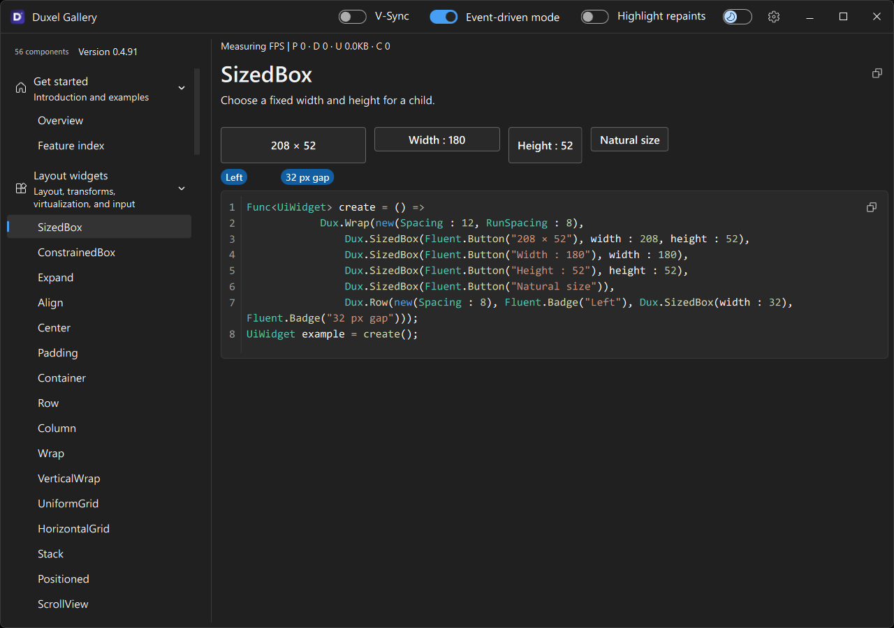
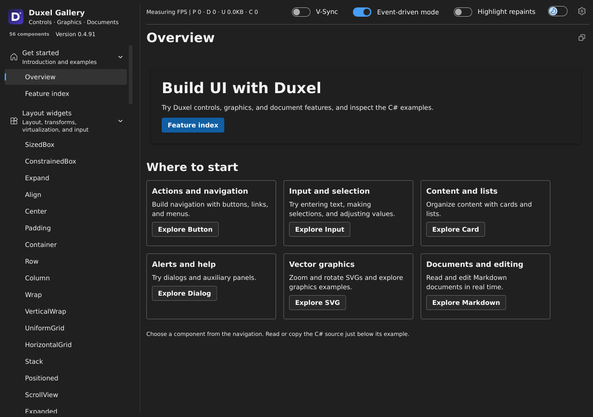
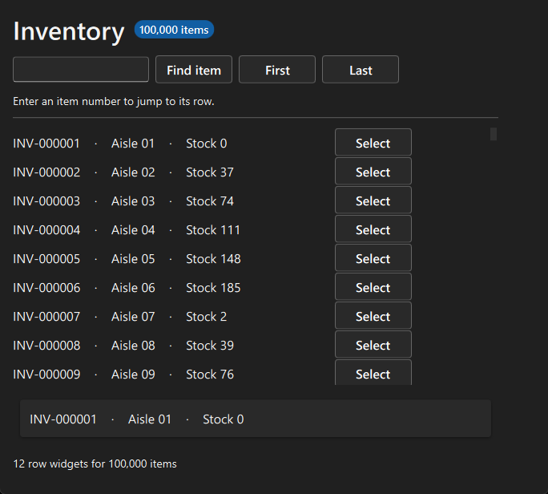
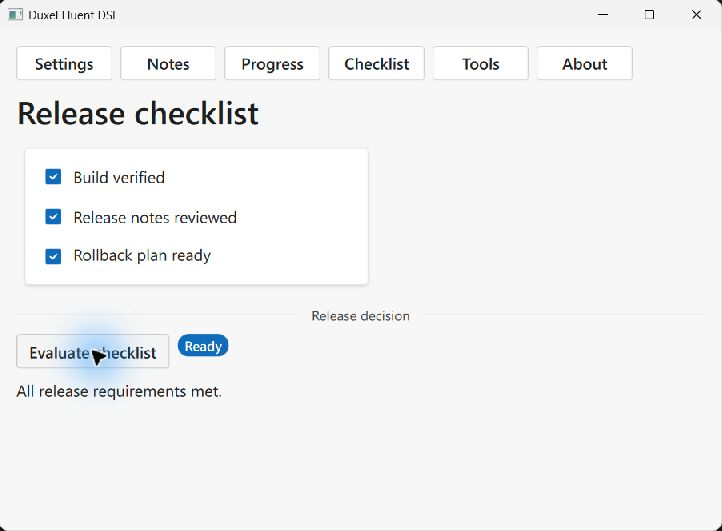

# Duxel · Cross-platform C# desktop UI for Windows and Linux

Build fast native desktop apps for **Windows and Linux** with a shared **C# / .NET** UI, **Fluent 2** controls, and a **Vulkan** renderer. Duxel is designed for **AI-assisted development and vibe coding**. Pick a working control in the Gallery, share its C# example with your coding assistant, and iterate in a file-based app (FBA). The same widget and state code runs with either platform host.

[한국어](README.ko.md) · [Documentation](docs/README.md) · [Examples](docs/fba-run-samples.md) · [Release history](docs/version-history.md)

## Try Duxel Gallery 0.4.0

Install the [.NET 11 SDK](https://dotnet.microsoft.com/en-us/download/dotnet/11.0) and use a graphical desktop with Vulkan. The Gallery shows working controls, layout, images, SVG, and Markdown with C# examples you can copy.

### Start a Windows app

Open PowerShell 7 and run the Gallery as a file-based app.

~~~powershell
curl.exe -fsSLO https://raw.githubusercontent.com/dimohy/Duxel/v0.4.0/samples/fba/duxel_gallery.cs && dotnet run --file duxel_gallery.cs
~~~

### Start a Linux app

Use Bash on Linux or WSLg with X11/Xwayland and Vulkan. [Linux setup](docs/linux-platform.md)

~~~bash
curl -fsSLO https://raw.githubusercontent.com/dimohy/Duxel/v0.4.0/samples/fba/duxel_gallery_linux.cs && dotnet run --file duxel_gallery_linux.cs
~~~

| Windows | Linux · Ubuntu 24.04 on WSLg |
| --- | --- |
|  |  |

From this repository, the library and both Gallery projects build for .NET **8, 9, 10, and 11**. See the [Gallery guide](docs/gallery-navigation.md) to select a runtime when running from source. The download commands above use the published 0.4.0 launchers.

## Start vibe coding with Duxel

1. Open **Gallery → Fluent controls → Input and selection → Switch** and try the widget. Copy the C# shown under the example.
2. Open the repository checkout in your AI coding assistant and find [`gallery_controls.cs`](samples/fba/gallery_controls.cs). Run the file once. You should see a switch, a Count button, and a count that changes only while the switch is on.
3. Paste the Gallery code and give your assistant a small change with a result you can check.

> Open `gallery_controls.cs`. Using the attached Gallery Switch example, add a **Reset count** button that sets the count to zero without changing whether counting is enabled. Reuse the existing `UiState<int>` and Fluent controls. Keep the Windows and Linux host setup and package version. Run the app and check that Count increases by one when enabled and Reset returns it to zero.

**Windows** · PowerShell 7

~~~powershell
dotnet run --file samples/fba/gallery_controls.cs
~~~

**Linux** · Bash with a desktop session and Fontconfig

~~~bash
dotnet run --file samples/fba/gallery_controls.cs -- "$(fc-match -f '%{file}' sans-serif)"
~~~

Run the same edited file on Windows and Linux. Check the switch, both buttons, and the displayed count on each. Use the [API and source map](docs/duxel-agent-reference.md) to give the assistant exact widget signatures.

## Run a Fluent 2 desktop app

The Calculator, Notepad, Large List, and Motion Canvas use the same C# source on Windows and Linux. The run guide includes each sample's dependencies and commands. [Run the examples](docs/fba-run-samples.md)

| Example | What to try |
| --- | --- |
| [Calculator](samples/fba/duxel_calculator.cs) | Chain decimal operations and try the divide-by-zero case. |
| [Notepad](docs/fba-run-samples.md#notepad) | Open and save a local note using the desktop menu bar. Run from the repository checkout. |
| [Large List](samples/fba/duxel_large_list.cs) | Scroll or jump through 100,000 rows with a virtualized viewport. |
| [Motion Canvas](samples/fba/duxel_render_motion.cs) | Adjust the number of animated shapes while the Fluent 2 controls stay interactive. |

## Try the Fluent 2 YAML preview

Build a six-screen file-based app with separate YAML views and C# actions. The source generator turns the views into Duxel widget calls and typed state at build time. Build the preview analyzer from this checkout, then try the four examples in the [Fluent 2 YAML guide](docs/fluent-dsl.md).

## Publish a small NativeAOT app

A minimal Fluent 2 app published to **4.85 MB on Windows x64** targeting .NET 11 and **4.98 MB on Linux x64** targeting .NET 10 with the opt-in compact build. The [NativeAOT guide](docs/native-aot.md) shows the baseline, exact byte counts, and reproducible commands.

## Build with Duxel

- Lay out Fluent 2 controls with `Dux`, style them with `Fluent`, and bind their values with `UiState<T>`.
- Reference the Windows or Linux host in a project or via `#:package` in a file-based app. The source projects target .NET 8, 9, 10, and 11. The published 0.4.0 host packages target .NET 8, 9, and 10, and the launchers above use the .NET 11 SDK.

[Start a C# app](docs/getting-started-fba.md) · [API and source map](docs/duxel-agent-reference.md) · [LLM-friendly documentation index](llms.txt)
