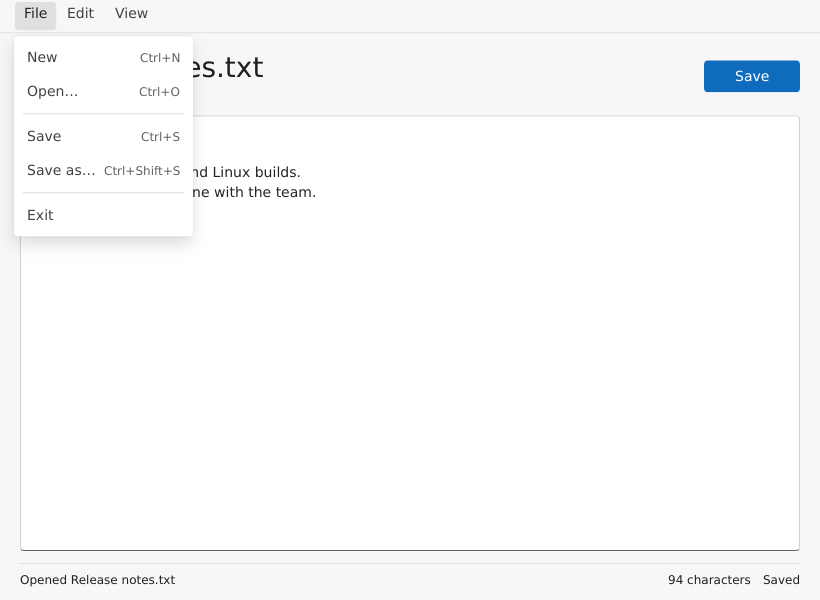

# Fluent 2 앱을 FBA로 실행하기

각 예제는 독립 C# 파일입니다. [.NET 11 SDK](https://dotnet.microsoft.com/en-us/download/dotnet/11.0)와 Vulkan이 필요합니다. Linux는 [설치 안내](linux-platform.ko.md)를 참고하세요. 파일을 이미 받았다면 `dotnet run --file <파일명.cs>`로 시작합니다.

Windows는 PowerShell 7, Linux는 Bash에서 실행합니다. 계산기, 대용량 목록, 움직이는 도형은 C# 파일을 받아 바로 실행할 수 있습니다. 메모장은 저장소의 메뉴 모음 구현을 사용합니다.

아래 네 앱은 Windows의 앱 색 모드를 따릅니다. Linux에서는 시작할 때 `gdbus`로 [데스크톱 색 모드 설정](https://flatpak.github.io/xdg-desktop-portal/docs/doc-org.freedesktop.portal.Settings.html)을 읽습니다. 데스크톱에 선호 설정이 없거나 WSLg처럼 설정 포털을 제공하지 않는 세션에서는 Fluent 밝은 테마를 사용합니다. Linux에서 색 모드를 바꿨다면 예제를 다시 실행하세요.

## 계산기

소수 연산을 이어서 하고, 입력을 지우거나 0으로 나눠 보세요. [C# 소스](../samples/fba/duxel_calculator.cs)

~~~powershell
curl.exe -fsSLO https://raw.githubusercontent.com/dimohy/Duxel/main/samples/fba/duxel_calculator.cs && dotnet run --file duxel_calculator.cs
~~~

~~~bash
curl -fsSLO https://raw.githubusercontent.com/dimohy/Duxel/main/samples/fba/duxel_calculator.cs && dotnet run --file duxel_calculator.cs
~~~

## 메모장

파일 메뉴로 문서를 열고 저장합니다. 편집 하위 메뉴와 보기 메뉴의 글자 수 표시도 써 보세요. Tab과 방향키로 메뉴를 탐색할 수 있습니다. Windows에서는 Alt+F·Alt+E·Alt+V로 메뉴를 바로 엽니다. Windows와 Linux 모두 저장소 루트에서 다음 명령으로 실행합니다. [C# 소스](../samples/fba/duxel_notepad.cs)

~~~sh
dotnet run --file samples/fba/duxel_notepad.cs
~~~

기존 문서를 열려면 명령 끝에 `-- path/to/note.txt`를 붙입니다.

## 대용량 목록

10만 행에서 휠과 스크롤 손잡이를 써 보세요. Top과 Bottom으로 양 끝을 오갈 수 있습니다. [C# 소스](../samples/fba/duxel_large_list.cs)

~~~powershell
curl.exe -fsSLO https://raw.githubusercontent.com/dimohy/Duxel/main/samples/fba/duxel_large_list.cs && dotnet run --file duxel_large_list.cs
~~~

~~~bash
curl -fsSLO https://raw.githubusercontent.com/dimohy/Duxel/main/samples/fba/duxel_large_list.cs && dotnet run --file duxel_large_list.cs
~~~

## 움직이는 도형

500개부터 5,000개까지 움직이는 원의 수를 조절해 보세요. 모션을 멈췄다가 다시 켤 수 있습니다. [C# 소스](../samples/fba/duxel_render_motion.cs)

~~~powershell
curl.exe -fsSLO https://raw.githubusercontent.com/dimohy/Duxel/main/samples/fba/duxel_render_motion.cs && dotnet run --file duxel_render_motion.cs
~~~

~~~bash
curl -fsSLO https://raw.githubusercontent.com/dimohy/Duxel/main/samples/fba/duxel_render_motion.cs && dotnet run --file duxel_render_motion.cs
~~~

## 더 작은 예제와 Gallery

- [Controls와 상태 연결](../samples/fba/gallery_controls.cs)은 `UiState<T>`, `Fluent.Switch`, `Fluent.Text`를 씁니다. Linux에서는 `dotnet run --file gallery_controls.cs -- "$(fc-match -f '%{file}' sans-serif)"`로 글꼴 경로를 지정합니다.
- [레이아웃 예제](../samples/fba/gallery_layout.cs)는 Windows에서 Align의 아홉 위치와 SizedBox의 크기 설정을 보여줍니다.
- [Gallery 사용법](gallery-navigation.ko.md)에서 레이아웃과 컨트롤, 이미지 표시 방식, SVG와 Markdown 예제를 확인할 수 있습니다.

[English](fba-run-samples.md)
