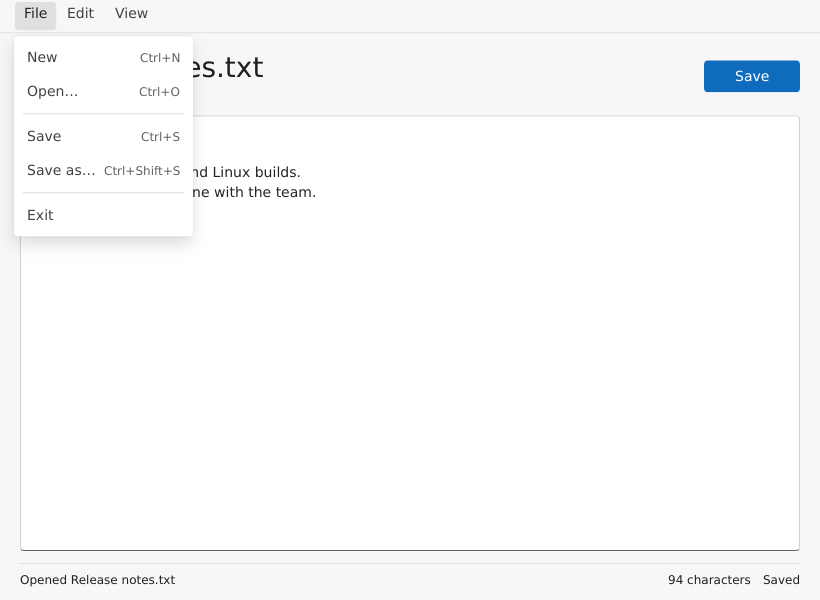

# Run Fluent 2 file-based apps

Clone the repository and run these commands from its root. Install the [.NET 11 SDK](https://dotnet.microsoft.com/en-us/download/dotnet/11.0) and a Vulkan driver. On Linux, follow the [setup guide](linux-platform.md).

The shared FBAs include a platform-specific file from the [Host directory](../samples/fba/Host) at build time. Keep Host next to the entry file if you copy a sample.

The four apps below use the Windows app color mode. On Linux they read the [desktop color preference](https://flatpak.github.io/xdg-desktop-portal/docs/doc-org.freedesktop.portal.Settings.html) at launch via `gdbus`. They use Fluent light when the session has no preference or no Settings portal, as can happen under WSLg. Restart a Linux sample after changing the desktop preference.

## Calculator

Try decimal arithmetic, chained operators and clear. [C# source](../samples/fba/duxel_calculator.cs)

~~~sh
dotnet run --file samples/fba/duxel_calculator.cs
~~~

## Notepad

Open or save a local document using the File menu. Try the Edit submenu and the character count in View. Use Tab and the arrow keys to navigate the menu bar. On Windows, try Alt+F, Alt+E, and Alt+V to open the menus directly. Run this command from the repository root on Windows or Linux. [C# source](../samples/fba/duxel_notepad.cs)

~~~sh
dotnet run --file samples/fba/duxel_notepad.cs
~~~

Add `-- path/to/note.txt` to open an existing document.

## Large List

Scroll 100,000 rows. Drag the scrollbar and use Top and Bottom to jump across the list. [C# source](../samples/fba/duxel_large_list.cs)

~~~sh
dotnet run --file samples/fba/duxel_large_list.cs
~~~

## Motion Canvas

Change the load from 500 to 5,000 animated circles. Pause and resume while using the Fluent 2 controls. [C# source](../samples/fba/duxel_render_motion.cs)

~~~sh
dotnet run --file samples/fba/duxel_render_motion.cs
~~~

## Fluent 2 YAML preview

Run the notes editor, transfer progress, release checklist, and tool grid in a single app with six YAML views. Build the preview analyzer from the checkout. [Build and run the YAML samples](fluent-dsl.md)

## Smaller examples and the Gallery

- [Controls and state](../samples/fba/gallery_controls.cs) uses `UiState<T>`, `Fluent.Switch`, and `Fluent.Text`. On Linux specify a font with `dotnet run --file samples/fba/gallery_controls.cs -- "$(fc-match -f '%{file}' sans-serif)"`.
- The [layout example](../samples/fba/gallery_layout.cs) demonstrates the nine Align positions and SizedBox sizing options on Windows.
- The [Gallery guide](gallery-navigation.md) covers layout, controls, image fit, SVG, and Markdown.

[한국어](fba-run-samples.ko.md)
