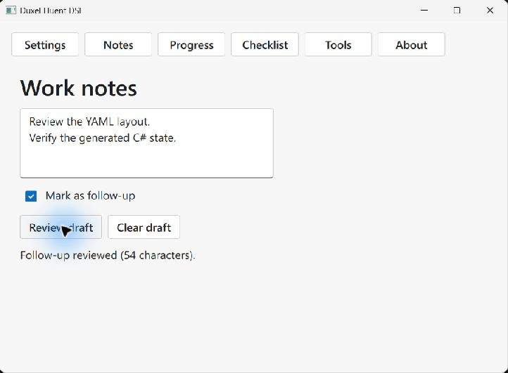
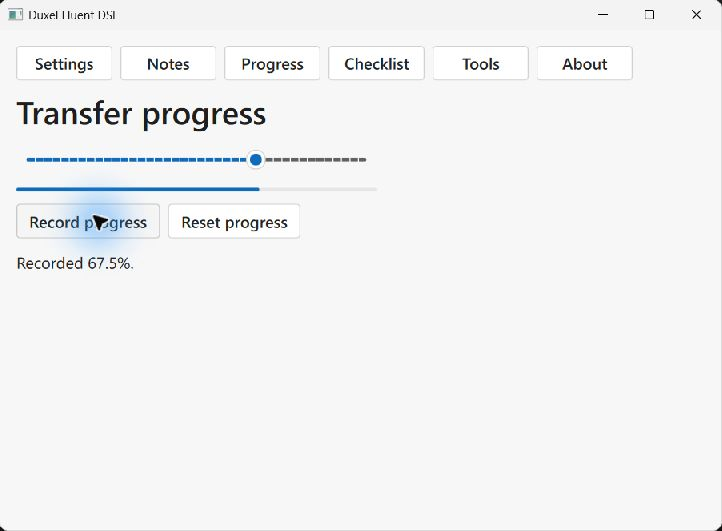
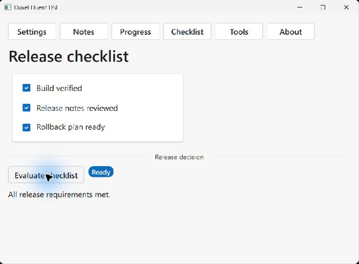
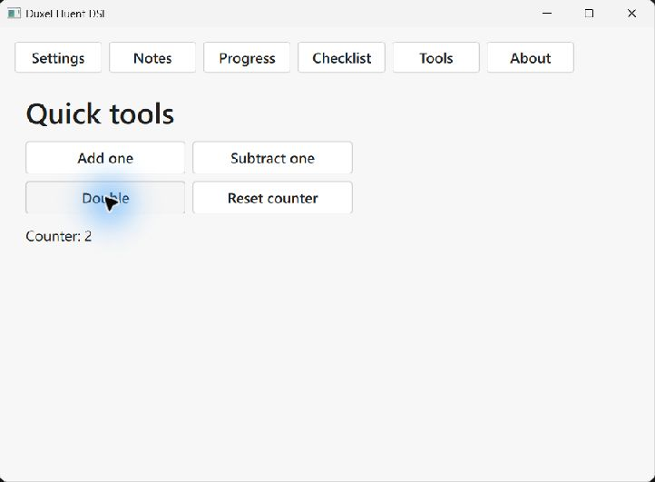

# Fluent 2 YAML 화면

Fluent DSL은 `.duxel.yaml` 파일을 기존 Fluent 2 컨트롤과 Dux 레이아웃을 만드는 C# 호출로 컴파일합니다. 앱은 생성된 화면과 타입이 정해진 상태를 사용합니다. YAML 파서는 빌드에 사용하는 분석기 패키지에 들어 있습니다.

## 예제 앱 실행

저장소 루트에서 미리 보기 패키지를 로컬 피드에 만듭니다. 예제는 Duxel 0.4.0 플랫폼 패키지와 직접 빌드한 컴파일러 패키지를 참조합니다.

```powershell
$feed = Join-Path (Get-Location) 'artifacts/fluent-dsl-feed'
dotnet pack src/Duxel.FluentDsl.Generator -c Release -o $feed -p:DuxelVersion=0.4.1-fluentdsl.4
$env:RestoreAdditionalProjectSources = $feed
dotnet run --file samples/fba/fluent_dsl/app.cs
```

Linux 셸에서는 `feed="$PWD/artifacts/fluent-dsl-feed"`와 `export RestoreAdditionalProjectSources="$feed"`를 사용합니다. 예제를 실행할 때 `dotnet run --file samples/fba/fluent_dsl/app.cs -- /usr/share/fonts/truetype/dejavu/DejaVuSans.ttf`처럼 설치된 글꼴 파일을 넘깁니다.

[FBA 진입 파일](../samples/fba/fluent_dsl/app.cs)은 `DuxelViewFiles=Views/**/*.duxel.yaml`로 YAML 화면 6개를, `#:include Actions/*.cs`로 C# 동작 파일을 포함합니다. 경로는 진입 파일을 기준으로 적습니다. 개별 YAML 경로를 세미콜론으로 나눠 지정할 수도 있습니다. 패키지는 YAML을 컴파일러와 파일 감시에 전달합니다. 프로젝트 파일을 쓰는 앱에서는 `AdditionalFiles`로 YAML 파일을 지정할 수 있습니다.

Windows와 Linux에서 같은 진입 파일의 `FluentDslHost.Run(options, args)`를 호출합니다. 생성기가 참조된 호스트 패키지에 맞춰 시작 코드를 만듭니다. Windows는 기존 `DuxelApp.Run` 경로와 창 최소 크기 설정을 사용합니다. Linux는 X11 호스트를 실행하고 명령줄에서 설치된 글꼴의 경로를 받습니다.

| 메뉴 | 해 볼 동작 | YAML |
| --- | --- | --- |
| Settings | 이메일 주소를 편집하고 알림을 켠 뒤 저장합니다. | [NotificationSettings](../samples/fba/fluent_dsl/Views/NotificationSettings.duxel.yaml) |
| Notes | 여러 줄로 초안을 쓰고 후속 작업으로 표시한 뒤 검토하거나 지웁니다. | [WorkNotes](../samples/fba/fluent_dsl/Views/WorkNotes.duxel.yaml) |
| Progress | 슬라이더로 진행률을 바꾸고 그 값을 기록하거나 초기화합니다. | [TransferProgress](../samples/fba/fluent_dsl/Views/TransferProgress.duxel.yaml) |
| Checklist | 릴리스 조건을 체크한 뒤 평가하면 배지에 현재 상태가 표시됩니다. | [ReleaseChecklist](../samples/fba/fluent_dsl/Views/ReleaseChecklist.duxel.yaml) |
| Tools | 두 열로 배치한 단추 네 개로 카운터 값을 바꿉니다. | [QuickTools](../samples/fba/fluent_dsl/Views/QuickTools.duxel.yaml) |
| About | 읽기 전용으로 구성한 화면을 엽니다. | [About](../samples/fba/fluent_dsl/Views/About.duxel.yaml) |

앱은 각 화면의 인스턴스를 하나씩 유지하므로 다른 메뉴로 갔다가 돌아와도 초안이나 체크 상태가 남습니다.

## 예제 동작 화면

Windows에서 파일 기반 앱을 실행하고 각 예제를 조작한 뒤 찍은 화면입니다.

| 작업 노트 | 전송 진행률 |
| --- | --- |
|  |  |
| **릴리스 체크리스트** | **빠른 도구** |
|  |  |

## 화면 작성

```yaml
schema: 1
screen: Settings
using: [Fluent]
state:
  Status: 준비
view:
  Dux.Column:
    spacing: 12
    children:
      - Input:
          label: 이메일
          value: { bind: Email }
      - Button:
          label: 저장
          onClick: Save
      - Text:
          text: { read: Status }
```

`using: [Fluent, Dux]`를 쓰면 해당 파일에서 `Input`이나 `Column`처럼 짧은 이름을 쓸 수 있습니다. `Fluent.Input`처럼 전체 이름을 적어도 됩니다. 여러 그룹에 같은 이름이 있으면 전체 이름으로 위젯을 지정합니다.

| 위젯 | YAML 속성 |
| --- | --- |
| `Dux.Column`, `Dux.Row` | `children`, 선택 속성 `spacing` |
| `Dux.Padding` | `all`, `child` |
| `Dux.Wrap` | `children`, 선택 속성 `spacing`과 `runSpacing` |
| `Dux.UniformGrid` | `columns`(양의 정수), `children`, 선택 속성 `spacing`(가로·세로 간격)과 `rowHeight` |
| `Dux.SizedBox` | `child`, 선택 속성 `width`와 `height` |
| `Fluent.Text` | `text`(문자열 또는 `read`), 선택 속성 `style`(글자 스타일) |
| `Fluent.Input`, `Fluent.Textarea` | `label`, `value`(문자열 바인딩), 선택 속성 `maxLength`와 `width`. Textarea에서는 `height`도 지정할 수 있습니다. |
| `Fluent.Switch`, `Fluent.Checkbox` | `label`, `value`(bool 바인딩) |
| `Fluent.Button` | `label`, `onClick`(C# 콜백 이름) |
| `Fluent.Slider` | `label`, `value`(float 바인딩), `minimum`, `maximum`, 선택 속성 `step`(양수) |
| `Fluent.ProgressBar` | `value`(0 이상의 수 또는 float `read`), 선택 속성 `maximum`(양수, 기본값 100)과 `height`(양수, 기본값 2) |
| `Fluent.Badge`, `Fluent.Divider` | `text`(문자열 또는 문자열 `read`). Divider에서는 생략할 수 있습니다. |
| `Fluent.Card` | `title`, `child` |

크기와 간격에는 0 이상의 유한한 수를 씁니다. `UniformGrid`는 부모가 너비의 상한을 정해 줘야 합니다. 필요하면 `SizedBox`로 감싸서 너비를 지정합니다. 슬라이더의 `maximum`은 `minimum`보다 커야 하며 두 값의 차이도 유한해야 합니다.

생성기는 `Duxel.Generated.Views`에 `SettingsState`와 `SettingsView`를 만듭니다. `Input`에 `value: { bind: Email }`을 쓰면 `UiState<string>`이 생깁니다. 한 화면에서 같은 이름을 참조한 곳은 이 상태를 함께 사용합니다. 위젯에서 기존 상태를 읽으려면 값의 타입에 맞춰 `{ read: 이름 }`을 씁니다. `state`에 문자열이나 bool, int의 초기값을 적을 수 있습니다. 35처럼 정수로 적은 초기값을 float로 만들려면 `{ type: float, initial: 35 }`처럼 타입을 지정합니다. 슬라이더가 바인딩으로 float 상태를 새로 만들면 초기값은 0입니다. 스키마나 타입 오류가 생기면 컴파일러가 해당 YAML 위치를 알려 줍니다.

```csharp
using var settings = SettingsView.Create(
    onSave : state => state.Status.Value = state.Email.Value,
    requestFrame : session.RequestFrame);

settings.State.Email.Value = "user@example.com";
```

앱에는 `settings.View`를 연결합니다. `onSave`는 위젯에서 편집한 바로 그 상태를 받습니다. 저장 동작은 같은 빌드에 포함한 다른 C# 파일에 둘 수 있습니다.

## 개발 중 실행 화면 갱신

Debug에서 `dotnet watch --file samples/fba/fluent_dsl/app.cs`로 예제를 시작합니다. 문구와 배치를 고치면 열어 둔 화면의 상태를 보존하면서 새 화면을 반영할 수 있습니다. 이벤트를 기다리는 앱에서 화면을 바로 갱신하려면 세션의 `RequestFrame`을 넘깁니다. YAML 오류가 생기면 빌드 오류를 표시하고 마지막 정상 화면을 유지합니다. 생성되는 타입이나 콜백 시그니처가 바뀌면 재시작이 필요할 수 있습니다.
