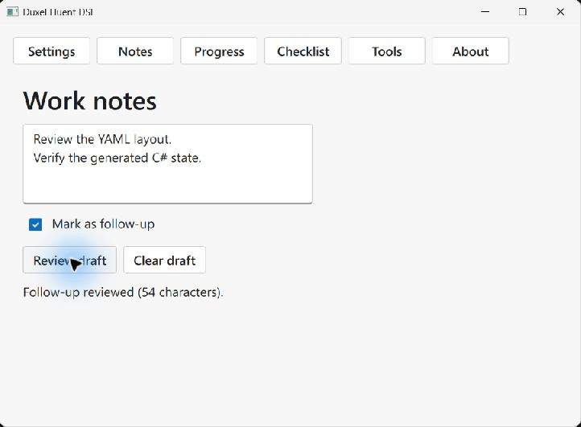
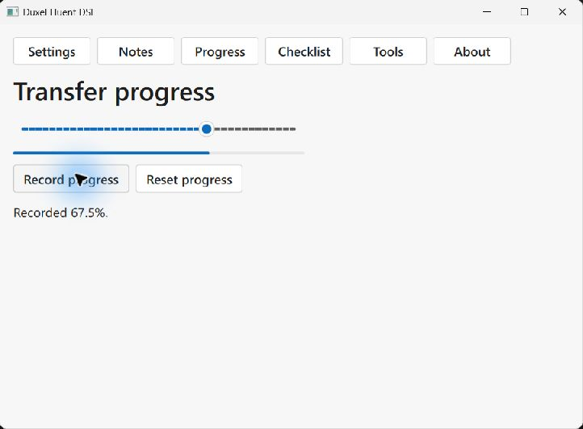
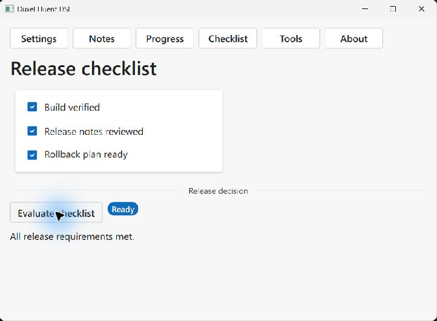
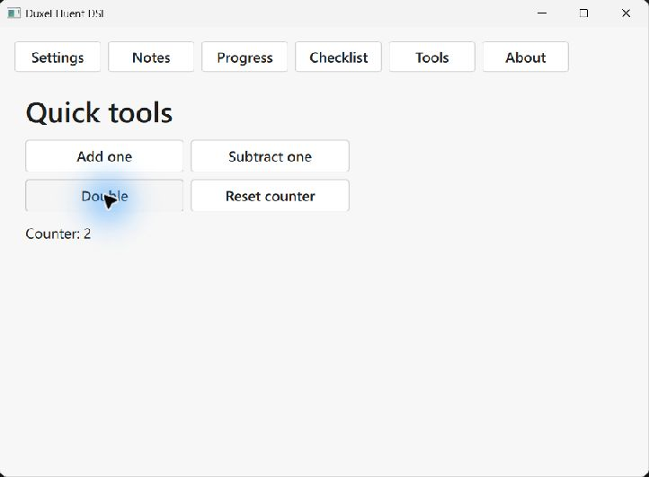

# Fluent 2 YAML views

The Fluent DSL compiles `.duxel.yaml` files into C# calls to the existing Fluent 2 controls and Dux layout widgets. The app uses the generated view and its typed state. The YAML parser is included with the build-time analyzer.

## Run the sample app

From the repository root, build the preview package in a local feed. The sample references the versioned Duxel 0.4.0 platform packages and the locally built compiler package.

```powershell
$feed = Join-Path (Get-Location) 'artifacts/fluent-dsl-feed'
dotnet pack src/Duxel.FluentDsl.Generator -c Release -o $feed -p:DuxelVersion=0.4.1-fluentdsl.4
$env:RestoreAdditionalProjectSources = $feed
dotnet run --file samples/fba/fluent_dsl/app.cs
```

In a Linux shell, set `feed="$PWD/artifacts/fluent-dsl-feed"` and `export RestoreAdditionalProjectSources="$feed"`. Pass an installed font file to the sample, for example `dotnet run --file samples/fba/fluent_dsl/app.cs -- /usr/share/fonts/truetype/dejavu/DejaVuSans.ttf`.

The [FBA entry](../samples/fba/fluent_dsl/app.cs) sets `DuxelViewFiles=Views/**/*.duxel.yaml` to include all six screens. Use `#:include Actions/*.cs` for their C# actions. Both paths are relative to the entry file. You can also give `DuxelViewFiles` a semicolon-separated list of individual paths. The package forwards the YAML files to the compiler and watcher. Project-based apps can use `AdditionalFiles`.

The same entry calls `FluentDslHost.Run(options, args)` on both platforms. The generator selects the startup code from the referenced host package. Windows uses the existing `DuxelApp.Run` bootstrap and applies the window minimum size. Linux uses its X11 runner and takes the installed font path from the command line.

| Open | Try | YAML |
| --- | --- | --- |
| Settings | Edit the email address, turn notifications on, and select Save. | [NotificationSettings](../samples/fba/fluent_dsl/Views/NotificationSettings.duxel.yaml) |
| Notes | Write a multiline draft, mark it for follow-up, then review or clear it. | [WorkNotes](../samples/fba/fluent_dsl/Views/WorkNotes.duxel.yaml) |
| Progress | Move the slider to update the progress bar, then record or reset the value. | [TransferProgress](../samples/fba/fluent_dsl/Views/TransferProgress.duxel.yaml) |
| Checklist | Mark the requirements and evaluate them to update the status badge. | [ReleaseChecklist](../samples/fba/fluent_dsl/Views/ReleaseChecklist.duxel.yaml) |
| Tools | Use the four buttons in a two-column grid to change a counter. | [QuickTools](../samples/fba/fluent_dsl/Views/QuickTools.duxel.yaml) |
| About | Open a second read-only view alongside the interactive samples. | [About](../samples/fba/fluent_dsl/Views/About.duxel.yaml) |

The app keeps one instance of each screen, so drafts, checkbox values, and other state survive navigation.

## Screens in action

These screenshots show the Windows FBA after using each sample.

| Work notes | Transfer progress |
| --- | --- |
|  |  |
| **Release checklist** | **Quick tools** |
|  |  |

## Write a view

```yaml
schema: 1
screen: Settings
using: [Fluent]
state:
  Status: Ready
view:
  Dux.Column:
    spacing: 12
    children:
      - Input:
          label: Email address
          value: { bind: Email }
      - Button:
          label: Save
          onClick: Save
      - Text:
          text: { read: Status }
```

`using: [Fluent, Dux]` lets you use names such as `Input` and `Column` within that file. You can also write qualified names such as `Fluent.Input`. Use a qualified name when imports make a short name ambiguous.

| Widget | YAML properties |
| --- | --- |
| `Dux.Column`, `Dux.Row` | `children`, optional `spacing` |
| `Dux.Padding` | `all`, `child` |
| `Dux.Wrap` | `children`, optional `spacing` and `runSpacing` |
| `Dux.UniformGrid` | `columns` (positive integer), `children`, optional `spacing` on both axes and `rowHeight` |
| `Dux.SizedBox` | `child`, optional `width` and `height` |
| `Fluent.Text` | `text` (literal or `read`), optional typography `style` |
| `Fluent.Input`, `Fluent.Textarea` | `label`, `value` (string binding), optional `maxLength` and `width`; Textarea also accepts `height` |
| `Fluent.Switch`, `Fluent.Checkbox` | `label`, `value` (bool binding) |
| `Fluent.Button` | `label`, `onClick` (C# callback name) |
| `Fluent.Slider` | `label`, `value` (float binding), `minimum`, `maximum`, optional positive `step` |
| `Fluent.ProgressBar` | `value` (nonnegative number or float `read`), optional positive `maximum` (defaults to 100) and `height` (defaults to 2) |
| `Fluent.Badge`, `Fluent.Divider` | `text` (literal or string `read`); Divider may omit it |
| `Fluent.Card` | `title`, `child` |

Layout sizes and gaps accept finite, nonnegative numbers. `UniformGrid` needs a bounded width from its parent. Use `SizedBox` to supply one when needed. The slider range must be finite with `maximum` greater than `minimum`.

The generator creates a `SettingsState` type and a `SettingsView` factory in `Duxel.Generated.Views`. `value: { bind: Email }` on an `Input` introduces a `UiState<string>`. References to `Email` within the same view instance share that state. A widget can read an existing state with `{ read: Name }` when its value type matches. Use `state` to set an initial string, bool, or int. The mapping `{ type: float, initial: 35 }` declares a float even though the initial value is written as a whole number. A slider binding can also introduce a float state with an initial value of zero. The compiler reports schema and type errors at their YAML locations.

```csharp
using var settings = SettingsView.Create(
    onSave : state => state.Status.Value = state.Email.Value,
    requestFrame : session.RequestFrame);

settings.State.Email.Value = "user@example.com";
```

Mount `settings.View` in the app. The generated `onSave` callback receives the same state the widgets edit. App logic can live in another C# file in the same compilation.

## Refresh a running development app

Run the sample with `dotnet watch --file samples/fba/fluent_dsl/app.cs` in Debug. Text and layout changes can update the existing window while keeping the same state. Pass the session's `RequestFrame` to wake an event-driven app when a view changes. An invalid YAML edit reports a build error and the app keeps its last working view. Changes to generated types or callback signatures may require a restart.
