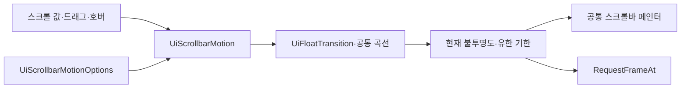

# 스크롤바 공통 모션

모든 스크롤바가 `UiScrollbarMotion`의 동일한 등장·유지·사라짐 정책을 사용합니다. 입력과 크기 계산은 기존 소비자가 맡고, 모션은 불투명도와 다음 시각만 반환하며, 공통 페인터가 트랙과 thumb를 그립니다.



| 소비 경로 | 모션 상태의 소유자 |
| --- | --- |
| 창·자식·목록·입력·ScrollView·메뉴·가상 목록 | 기존 UiState 스크롤 정체성, 소유 축 해제 때 함께 제거 |
| Tooltip | 컨텍스트 안의 약한 Tooltip 소유자별 상태 |
| 탭 오버레이 | 탭 인스턴스가 직접 소유하는 상태 |

기본은120ms 등장·400ms 정지 유지·160ms 사라짐입니다. 표준 스크롤바는 이동·드래그·트랙 호버로 나타나며, 탭은 요청대로 이동·드래그만으로 나타납니다. 드래그 중 정지하면 표시를 유지하지만 등장 완료 뒤에는 주기 프레임을 요청하지 않습니다. 늦게 도착한 프레임은 실제 숨김 기한에서 경과한 시간을 반영합니다. 사라짐 도중 다시 움직이면 현재 불투명도에서 이어집니다.

공통 디자인의 `ControlSkins.Scrollbar.Motion`에서 정책을 설정합니다.

```csharp
var design = UiCompiledDesign.Windows11;
context.SetDesign(design with
{
    ControlSkins = design.ControlSkins with
    {
        Scrollbar = design.ControlSkins.Scrollbar with
        {
            Motion = new UiScrollbarMotionOptions(HoldSeconds: .4)
            {
                Enter = new(.12),
                Exit = new(.16)
            }
        }
    }
});
```

탭별 명시적 재정의는 `UiTabListScrollOptions.Motion`입니다. `ReducedMotion`은 전환을 즉시 적용하며 정지 유지 기한은 보존합니다. `AlwaysShowThumb`은 항상 표시하는 명시적 정책으로 유지합니다. 보이지 않는 축이나 해제한 소유자는 새 애니메이션 기한을 만들지 않습니다. 새 Timer·스레드·무한 렌더 플래그는 없습니다. 기존 스크롤 영역의 배치와 포인터·휠·접근성 계약은 유지하고, 탭의 하단 표시만 공간을 차지하지 않는 오버레이입니다.

기본 타임라인은 [유한 전환 설계](finite-transitions.ko.md)를 따릅니다. NativeAOT·물리 보조기술·전체 Fluent 적합성은 별도 검증 범위입니다.


View 계열은 정지 후 완전히 사라지지 않고 모션 기준 유휴 불투명도 `0.28`로 옅게 남습니다. `UiScrollbarMotionOptions.IdleOpacity`로 설정합니다. 탭 하단 오버레이는 앞선 요청에 따라 유휴 값 `0`을 사용합니다. 두 경로 모두 같은 전환·기한 모듈을 사용합니다.
